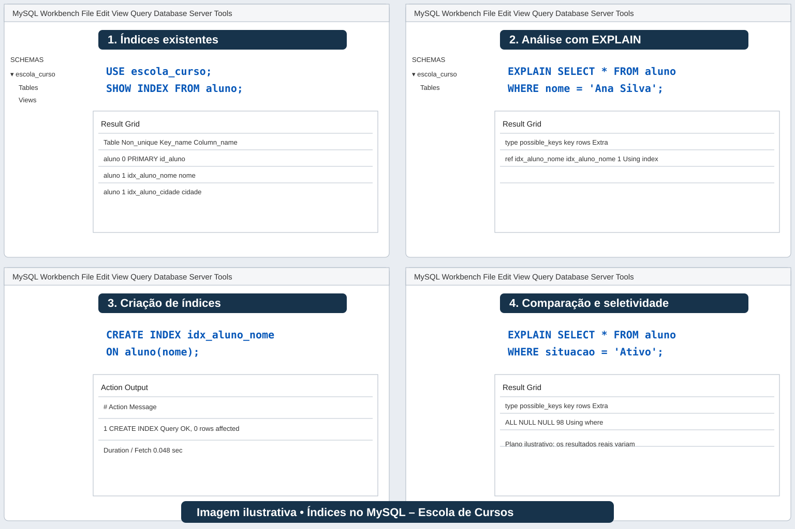

# Índices no MySQL - Escola de Cursos

Neste repositório organizei minha atividade prática sobre índices no MySQL. A proposta foi estudar como os índices ajudam a melhorar as consultas e como analisar o plano de execução usando o `EXPLAIN`.

Durante a atividade, trabalhei com comandos para consultar os índices existentes, criar índices simples e compostos, analisar filtros e relacionamentos com `JOIN`, observar consultas com ordenação e entender quando faz sentido remover um índice.

## O que tem aqui

Os arquivos SQL estão separados por etapa, com comentários para facilitar a leitura e a execução:

- `sql/01_indices_existentes.sql`: consulta dos índices que já existem.
- `sql/02_explain_consultas.sql`: análise inicial das consultas com EXPLAIN.
- `sql/03_indices_simples.sql`: criação de índices simples.
- `sql/04_seletividade.sql`: análise de seletividade.
- `sql/05_indices_compostos.sql`: índices compostos e ordem das colunas.
- `sql/06_indices_joins.sql`: consultas que usam relacionamentos.
- `sql/07_indices_financeiros.sql`: consultas relacionadas a mensalidades.
- `sql/08_order_by.sql`: análise de ordenação.
- `sql/09_remocao_indices.sql`: remoção e comparação de índices.
- `sql/10_desafio_dba.sql`: etapa final de análise e otimização.

## Imagem ilustrativa

A imagem abaixo é um modelo visual da interface do MySQL Workbench, feito para acompanhar a organização da atividade. Os dados e resultados exibidos são ilustrativos, não representam uma execução real.

## Como executar

1. Abra o MySQL Workbench e conecte-se ao servidor.
2. Selecione o banco de dados usado na atividade: `escola_curso`.
3. Abra os arquivos da pasta `sql` e execute cada etapa na ordem.
4. Confira os nomes das tabelas e colunas no seu banco antes de executar. Se a estrutura estiver diferente, ajuste os comandos.
5. Compare os resultados apresentados pelo `EXPLAIN` antes e depois de criar os índices.

Os resultados do EXPLAIN podem mudar de acordo com os dados existentes, as estatísticas e a versão do MySQL. Por isso, é importante conferir o resultado no próprio banco.

## O que aprendi

Com essa atividade, pude praticar a análise de consultas e entender melhor como os índices influenciam a busca dos dados. Também percebi que não basta criar índices em todas as colunas: é preciso observar os filtros utilizados, os relacionamentos e o custo de manter esses índices.

---

**Disciplina:** Administração em Banco de Dados: Otimização e Segurança  
**Curso:** Engenharia de Software e ADS  
**Professor:** Niltemberg Carvalho  
**Banco utilizado:** `escola_curso`
